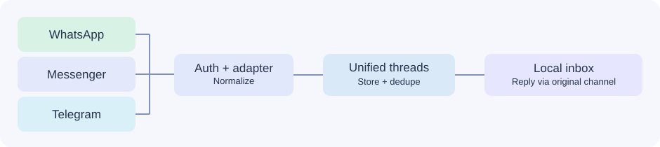

# ChannelBridge — A Multi-Channel Chat Hub

> A useful, small, original TypeScript project: one inbox for WhatsApp, Facebook Messenger and Telegram, with real adapter code and a no-credentials local demo.

**Concept:** Different chat APIs, one consistent conversation model. Chat agents can understand a conversation without handling each provider's webhook format; replies always go back to the original channel and account.

## What you can do today

- **Use the local inbox immediately:** launch, open a browser, test prefilled conversations, simulate new inbound messages, and reply without credentials.
- **Connect supported chat APIs:** webhook verification/parsing and text-only outbound adapters for Telegram Bot API, WhatsApp Cloud API, and Messenger Platform.
- **Persist conversations locally:** demo and real messages are stored separately in a JSON data file.
- **See sensible failure behavior:** duplicate webhook events are ignored; provider send failures are recorded; outbound requests aren't silently marked delivered.
- **Verify behavior:** tests cover cross-channel separation, webhook authentication, API payload construction, deduplication, persistence, and failure handling.



## Quick start — no API keys needed

Requires **Node.js 22.16+**. No production npm dependencies.

**Windows PowerShell**

```powershell
Copy-Item .env.example .env
npm start
```

**macOS/Linux**

```bash
cp .env.example .env
npm start
```

Open **http://127.0.0.1:4177**. Three clearly labeled **SIMULATED** conversations are ready. Pick a thread, reply, or use **Simulate inbound** to create another.

The `data/` folder is ignored by Git. To reset your demo: stop the server and delete `data/inbox.json`.

`npm test` runs the tests. `npm install` followed by `npm run check` additionally checks types; GitHub Actions runs both.

## Connect real APIs

All adapters are **text-only**, and integrations are disabled unless credentials are set. External providers require a public HTTPS callback (for example, a properly secured reverse proxy). **Never expose the unauthenticated admin dashboard through a public tunnel.** If binding beyond loopback, set a strong `ADMIN_TOKEN`, restrict exposed endpoints and apply HTTPS.

### Telegram

1. Create a Telegram bot using **@BotFather**, get the bot token.
2. In `.env`, set `TELEGRAM_BOT_TOKEN` and a random `TELEGRAM_WEBHOOK_SECRET` (letters, digits, underscores, hyphens).
3. Register `https://YOUR-DOMAIN/webhooks/telegram` using Telegram's `setWebhook` with `secret_token` equal to `TELEGRAM_WEBHOOK_SECRET`.
4. Send a **private text** message to the bot. The conversation appears under Telegram; human replies use `sendMessage`.

Telegram: https://core.telegram.org/bots/api

### WhatsApp Cloud API

1. In Meta for Developers, configure a WhatsApp Business account and a phone number ID.
2. Set `META_VERIFY_TOKEN` and `META_APP_SECRET` from your Meta app, along with `WHATSAPP_PHONE_NUMBER_ID` and `WHATSAPP_ACCESS_TOKEN`.
3. Subscribe the WhatsApp Business Account to the `messages` webhook and configure `https://YOUR-DOMAIN/webhooks/meta`.
4. Incoming text appears in the inbox; human text replies use `/{phone-number-id}/messages` within the supported customer-service messaging window.

Meta's official collection: https://www.postman.com/meta/whatsapp-business-platform/overview

### Facebook Messenger

1. Configure a Facebook Page, Messenger webhooks and appropriate messaging permissions.
2. Set the shared Meta webhook variables, `MESSENGER_PAGE_ID` and `MESSENGER_PAGE_ACCESS_TOKEN`.
3. Subscribe your Page to `messages` events at the same `/webhooks/meta` endpoint.
4. Incoming text appears as Messenger; replies use the Page's Send API during the standard messaging window.

Messenger documentation: https://developers.facebook.com/documentation/business-messaging/messenger-platform/send-messages

**Provider restrictions:** Meta permissions, app review, customer messaging windows, business policies and templates still apply. Successful setup requires legitimate provider approval, not just API keys. Live delivery cannot be validated without your credentials and permitted test accounts.

## Folder structure

```text
src/
  types.ts               # Shared message/conversation contracts
  storage.ts             # Serialized persistence, deduplication
  service.ts             # Inbound simulation and outbound coordination
  server.ts              # HTTP API, webhook security and routing
  providers/
    telegram.ts          # Telegram adapter
    meta.ts              # WhatsApp + Messenger adapters, Meta signatures
public/
  index.html             # Usable inbox UI
  styles.css
  app.js                 # Safe DOM rendering, search, reply, simulation
tests/
  inbox.test.ts
  providers.test.ts
docs/
  ARCHITECTURE.md
.github/workflows/ci.yml
```

## API endpoints

| Method | Path | Purpose |
|---|---|---|
| GET | `/api/health` | Minimal health check |
| GET | `/api/status` | Whether credentials are configured (never values) |
| GET | `/api/threads` | List normalized conversations |
| GET | `/api/threads/:id/messages` | Conversation messages |
| POST | `/api/threads/:id/reply` | Explicit human reply, `{"text":"..."}` |
| POST | `/api/demo/inbound` | Simulated inbound, only when demo enabled |
| POST | `/webhooks/telegram` | Telegram private messages; validated secret header |
| GET | `/webhooks/meta` | Meta webhook challenge/verification |
| POST | `/webhooks/meta` | Meta signed WhatsApp/Messenger webhooks |

## Design choices

**Keep business logic independent from channel APIs.** Each provider adapter normalizes its payload to the same `Incoming` type. Threads are keyed by mode + channel + provider account + external user ID so different people/accounts never blend. A reply uses the actual thread's channel; there is no universal broadcast endpoint.

**No AI for its own sake.** A chat hub isn't the AI engine. This project deliberately has no LLM dependency: it's a reusable communication layer that can later integrate with human agents or separate AI services.

**No source from ChatAware.** This implementation is a standalone demonstration inspired by common multi-channel messaging problems, not a dump of an existing private product.

## Security and deployment limitations

This is a **local single-operator reference app**, not production software. It defaults to `127.0.0.1` with no admin token for local convenience. **A public tunnel to that localhost port would expose the dashboard and APIs unless you first configure auth and restrict routing.** For production, add a real login and per-user authorization, encrypted secrets storage, a transactional database, webhook queuing, retry policies, message retention, structured observability, tests with real provider credentials, and API-specific compliance checks.

See [architecture and security notes](docs/ARCHITECTURE.md).

## Interview talking points

- Why normalize webhooks instead of coupling the inbox to a vendor?
- How do account-scoped thread identities prevent conversations from blending?
- What happens if a provider retries a webhook?
- What happens if a provider send fails after a timeout?
- Why keep AI orchestration out of the messaging transport layer?

**Portfolio note:** The project showcases code organization, API integrations, security boundaries, UI, testing, and practical architecture decisions. No live commercial integration is claimed.
